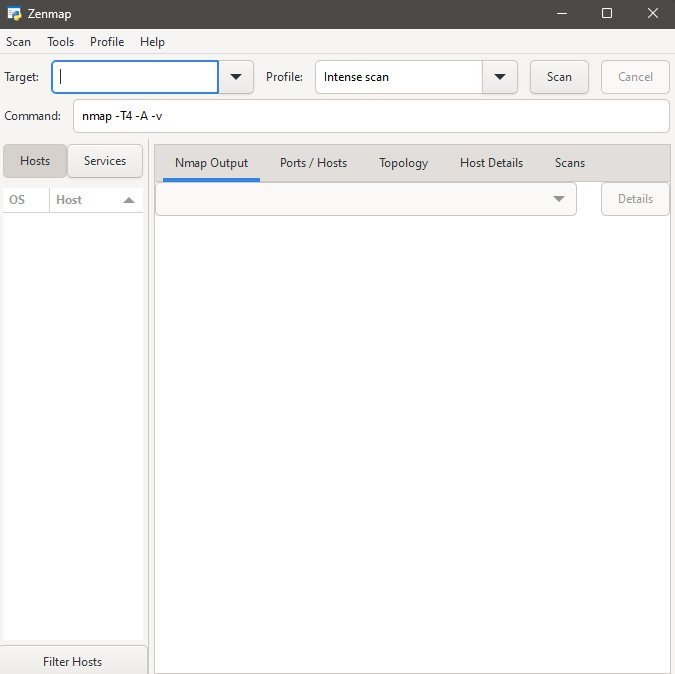
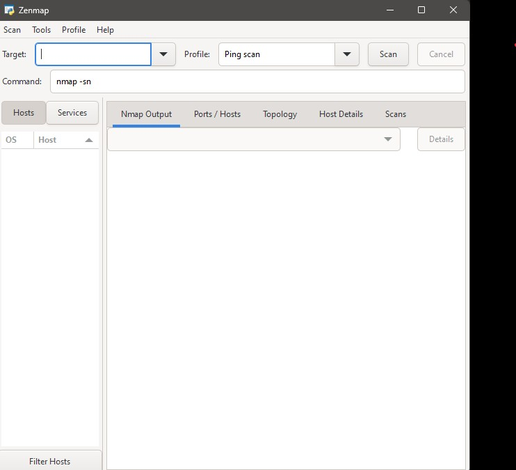
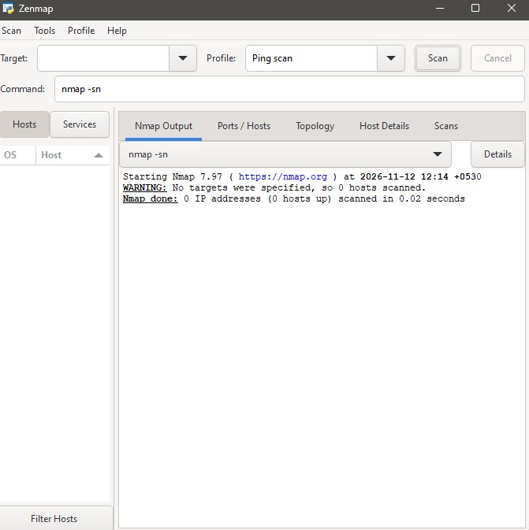

# NETWORKWALKS-RUSHDHA-B084K-WK2-PM5-zenmap-network-scanning
Practical cybersecurity exercise using Nmap and Zenmap to perform local network discovery, identify live hosts, explore network scanning techniques, and understand network topology through graphical scanning results.

# W2-PM5 – Network Scanning with Nmap and Zenmap

## Project Overview

This practical cybersecurity exercise focuses on network discovery and scanning using **Nmap (Network Mapper)** and its graphical interface, **Zenmap**.

Nmap is a network exploration and security auditing tool used to identify active hosts, discover open ports, and gather information about devices connected to a network. Zenmap provides a graphical interface that makes it easier to configure scans, execute commands, and review scanning results.

The exercise involved identifying the local network configuration, performing a ping scan to discover active hosts, reviewing scan results, and exploring network topology.

## Objectives

- Understand the purpose and functionality of Nmap and Zenmap.
- Identify the local IP configuration and network subnet.
- Perform network discovery using a ping scan.
- Identify active hosts within the local network.
- Understand how Nmap displays scanning results.
- Explore network topology visualisation and scanning reports.

## Tools and Technologies

| Tool | Purpose |
|---|---|
| Nmap | Network discovery and security scanning |
| Zenmap | Graphical interface for configuring and reviewing Nmap scans |
| Windows Command Prompt | Identifying local network configuration |
| Windows Operating System | Environment used for the practical exercise |

## Practical Methodology

### Step 01 – Installing and Launching Zenmap

Zenmap was installed and launched on the Windows system. The application interface was explored to understand its scanning configuration options, command field, scan profiles, and output display.

### Step 02 – Identifying Local Network Configuration

The Windows Command Prompt was used to identify the local network configuration.

**Command executed:**

```cmd
ipconfig
```

The command was used to identify the following network details:

- IPv4 Address
- Subnet Mask
- Default Gateway

The local IP address and subnet information were then used to determine the appropriate network range for the scanning activity.

*Note: Personal network addresses and subnet information are intentionally excluded from this public repository.*

### Step 03 – Performing a Ping Scan

A ping scan was configured in Zenmap to discover active hosts within the identified local network range.

The ping scan helps determine which hosts are responding to network discovery probes without performing a full port scan.

**Nmap command format:**

```bash
nmap -sn <network-range>
```

**Command explanation:**

| Parameter | Description |
|---|---|
| `nmap` | Executes the Nmap scanning tool |
| `-sn` | Performs host discovery without a port scan |
| `<network-range>` | Represents the local network range identified during the previous step |

The actual network range should be taken from the local network configuration rather than copied from another example.

### Step 04 – Reviewing Nmap Scan Output

After executing the scan, the output section in Zenmap was examined to understand how Nmap presents scanning information.

The results interface provides information about the scan process, discovered hosts, and other available scan details.

This step helped develop familiarity with interpreting Nmap output through its graphical interface.

### Step 05 – Exploring Network Topology

Zenmap also provides a topology view that can visually represent discovered hosts and their relationships based on the available scan information.

This feature was explored to understand how network scanning results can be presented graphically.

*Note: The personal network topology screenshot and PDF are not included in this public repository to protect private network information.*

## Screenshots and Evidence

The following screenshots document the application setup and scanning process:

### 01 – Zenmap Application



### 02 – Nmap Ping Scan Command



### 03 – Nmap Scan Command Output



## Key Learning Outcomes

- Gained practical experience using Nmap and Zenmap.
- Learned how to identify local network configuration using Command Prompt.
- Understood how to determine a network range for scanning.
- Performed host discovery using Nmap ping scanning.
- Learned how to configure scans and review output in Zenmap.
- Explored graphical network topology visualisation.
- Recognised the importance of protecting private network information when documenting security assessments.

## Ethical Considerations

Network scanning should only be performed on networks owned by the user or where explicit permission has been granted.

Scanning unauthorised networks or devices may violate privacy and security policies. Network information, including IP addresses, MAC addresses, and topology details, should be handled carefully and should not be unnecessarily disclosed.

## Conclusion

This exercise provided practical experience with Nmap and Zenmap for network discovery and scanning. By identifying local network configuration, configuring ping scans, and exploring the graphical output, the activity demonstrated how network scanning tools help security professionals understand network environments and identify active hosts.

---

**Project:** NetworkWalks Cybersecurity Internship – Week 02  
**Task:** W2-PM5 – Network Scanning with Nmap and Zenmap  
**Author:** Rushdha
